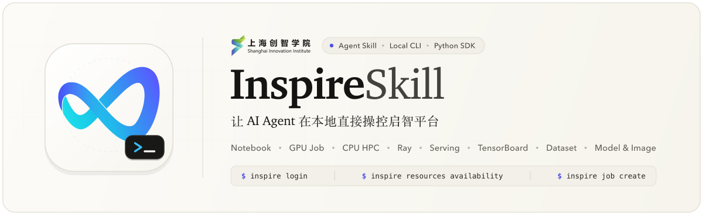

<p align="center">
  <picture>
    <source media="(prefers-color-scheme: dark)" srcset="assets/hero-dark.svg">
    <source media="(prefers-color-scheme: light)" srcset="assets/hero.svg">
    
  </picture>
</p>

<p align="center">
  <a href="https://pypi.org/project/inspire-skill/"></a>
  <a href="cli/"></a>
  <a href="#-支持的-agent-客户端"></a>
  
  <a href="LICENSE"></a>
</p>

<p align="center">
  <a href="#-项目初衷与定位">项目定位</a> ·
  <a href="#-快速上手">快速上手</a> ·
  <a href="#-日常使用方式">使用体验</a> ·
  <a href="#-能力全景">能力全景</a> ·
  <a href="#-python-sdk">Python SDK</a> ·
  <a href="#-支持的-agent-客户端">支持客户端</a> ·
  <a href="#-校外访问与代理配置">校外代理</a> ·
  <a href="#-文档索引">文档索引</a>
</p>

---

## ✨ 项目初衷与定位

在上海创智学院（SII）的日常科研中，[启智平台](https://qz.sii.edu.cn)承载着核心算力，但传统的网页端操作往往也是实验链路里最拖慢节奏的一环：查配额、开 Notebook、提训练、同步代码、看日志都要在浏览器里反复点选；碰上 GPU 训练区无法直连外网、`H100` / `H200` 节点不开放常规 SSH 等限制，配环境和排查问题更是费时费力。

**InspireSkill** 的目标，是把启智平台的全部操作搬进本地命令行，并配齐面向 AI Agent 的技能手册与 Python SDK。你不需要改变原有的开发习惯——继续在熟悉的 Codex、Claude Code、Cursor 等客户端和本地终端里写代码、管 Git，就能直接通过对话或命令行完成平台上的全套操作。

在 [@realZillionX](https://github.com/realZillionX)、[@JingYiJun](https://github.com/JingYiJun) 等开发者的长期打磨下，`inspire` CLI 并不是简单地把网页接口翻译成命令，而是围绕真实科研场景把整条实验链路彻底打通：

- **覆盖实验全流程的平台操作**：从查询项目余额与计算组实时空闲卡数、管理交互式 Notebook、提交单机/多机 GPU 训练、运行 CPU Slurm 批处理、拉起弹性 Ray 集群、部署在线推理服务，到管理自定义镜像、登记模型与挂载数据广场数据集，所有日常操作都能在终端直接完成。
- **直接按名字操作，人好敲、Agent 也好调**：工作空间、项目、计算组、镜像、模型和任务全部直接使用平台上的名称与本地账号别名，无需翻找底层内部 ID；所有命令均支持 `--json` 输出，方便 Agent 和自动化脚本稳定读取。
- **填平断网环境、受限节点与参数暗坑**：开放节点支持一键生成 OpenSSH 配置接入本地终端与 VS Code Remote，`H100` / `H200` 受限节点自动切换至 `JupyterTerminal` 执行命令与打开终端；内置断网区平台内部软件源指引、在线保存与单层压平镜像、镜像可见性调整，并在提交 HPC 任务前自动拦截物理配额与 Slurm 参数冲突，避免空跑或卡死排队。
- **不用打开浏览器也能掌握训练现场**：直接在命令行查询空闲 8 卡整节点数与可抢占低优卡数、合并查看控制器与容器调度事件、汇总多机多卡日志、排查宿主机内核 OOM 等节点故障、进入运行中的任务容器终端，甚至直接读取 TensorBoard 的 loss 与评测指标数值。

### 套件组成

| 组件 | 作用与定位 |
| --- | --- |
| **`inspire`&nbsp;CLI** | 覆盖资源与配额查询、Notebook、GPU Job、CPU HPC、Ray、Serving、TensorBoard、镜像、模型注册表与官方数据集的本地命令行工具。 |
| **`SKILL.md`&nbsp;与&nbsp;`references/`** | 面向 AI Agent 编排的操作规范与领域参考手册，涵盖任务选型、环境准备、实时巡检与清理闭环，由安装器自动部署至本机 Agent 客户端。 |
| **Python&nbsp;SDK** | 随 `inspire-skill` 一同安装的同步（`InspireClient`）与异步（`InspireAsyncClient`）客户端，与 CLI 共享账号会话与类型化资源模型。 |

### 与 QWorks 的区别

启智推出的 [QWorks](https://qworks.tech/solutions/sii) 是独立桌面客户端，需要将对话与开发迁移至其自有界面。InspireSkill 则直接嵌入你现有的本地开发工具链：

| 对&#8288;比&#8288;维&#8288;度 | QWorks | InspireSkill |
| --- | --- | --- |
| **使&#8288;用&#8288;入&#8288;口** | 绑定 QWorks 独立桌面端 | 接入本地主流 Agent 客户端（共支持 13 款），也可在终端或脚本中直接调用 |
| **模&#8288;型&#8288;订&#8288;阅** | 无法复用其他客户端已有订阅，外部模型需另配接口 | 直接沿用现有 Agent 客户端的模型配置与订阅套餐 |
| **平&#8288;台&#8288;覆&#8288;盖** | 在客户端界面内连接平台环境 | CLI 与 Python SDK 完整覆盖配额情报、六类计算负载、镜像、模型与数据广场 |
| **工&#8288;程&#8288;协&#8288;同** | 围绕客户端内部会话展开 | 与本地 Git 仓库、编辑器、Shell 脚本及 `--json` 自动化流水线无缝配合 |

---

## 🚀 快速上手

支持 **macOS**、**Linux** 与原生 **Windows**（无需 WSL）。所有命令与参数的准确用法请以 `inspire --help` 及各子命令 `--help` 为准。

### 1. 安装

**macOS / Linux**（需 Python 3.10+、`bash`、`curl`、`tar`，以及 `uv` 或 `pipx`；若尚未安装 `uv`，先执行第一行）：

```bash
curl -LsSf https://astral.sh/uv/install.sh | sh
curl -fsSL https://raw.githubusercontent.com/realZillionX/InspireSkill/main/scripts/install.sh | bash
```

**Windows PowerShell**（需 Python 3.10+、`uv` 或 `pipx`，以及系统 OpenSSH 客户端；在克隆后的仓库根目录执行）：

```powershell
powershell -c "irm https://astral.sh/uv/install.ps1 | iex"
Add-WindowsCapability -Online -Name OpenSSH.Client~~~~0.0.1.0
Set-ExecutionPolicy -Scope Process Bypass
.\scripts\install.ps1
```

安装器会从 PyPI 安装 `inspire-skill`，准备 Playwright Chromium 运行时，并将 `SKILL.md` 与 `references/` 自动写入本机检测到的 Agent 客户端目录。若本机暂未安装任何 Agent 客户端，CLI 仍会正常安装，后续安装客户端后运行 `inspire update` 即可补装 Skill 文件。

<details>
<summary><b>⚙️ 可选安装参数、PyPI 镜像加速与 Windows 环境提示</b></summary>

- **安装器参数（macOS / Linux）**：可通过 `bash -s -- --harness codex,claude` 指定目标客户端；`--no-cli` 仅安装 Skill 文档（未检测到且未指定客户端时报错退出）；`--no-schedule` 跳过 macOS 每日更新检查任务。
- **安装器参数（Windows）**：支持 `-SkipPlaywright`（跳过浏览器运行时下载）、`-SkipSkill`（仅安装 CLI）与 `-Version <x.y.z>`（安装指定版本）。
- **PyPI 镜像加速**：Python 依赖首次下载约 90 MB，Chromium 运行时约 150 MB。慢速网络下可通过 `--index-url`（或 PowerShell `-IndexUrl`）为本次包安装指定镜像源（仅作用于 Python 包下载，不修改浏览器与 Skill 下载源，日志会自动脱敏凭据）：
  ```bash
  curl -fsSL https://raw.githubusercontent.com/realZillionX/InspireSkill/main/scripts/install.sh | bash -s -- --index-url https://mirrors.aliyun.com/pypi/simple/
  ```
  未显式传参时保留当前环境变量（`uv` 优先读取 `UV_DEFAULT_INDEX` 与 `UV_INDEX_URL`，`pipx` 读取 `PIP_INDEX_URL`）。
- **Windows 原生 SSH 注意事项**：
  - 运行 `Get-Command ssh -All` 确认实际调用的 `ssh.exe`；系统 OpenSSH 与 Git for Windows 自带 OpenSSH 对 `ProxyCommand` 的解析存在差异。
  - Windows PowerShell 5.1 的 `>>` 默认使用 UTF-16LE 编码，写入 SSH 配置时请改用：`inspire notebook ssh-config <notebook> | Out-File -Encoding utf8 -Append $env:USERPROFILE\.ssh\config`（PowerShell 7+ 可直接使用 `>>`）。
  - 若提示 `UNPROTECTED PRIVATE KEY FILE`，请收紧 `%USERPROFILE%\.ssh` 目录 ACL 权限。文件传输可直接使用 `inspire notebook scp`，无需安装 `rsync`。

</details>

### 2. 登录与初始化

若在校园网外访问平台，请先参考[校外访问与代理配置](#-校外访问与代理配置)设置网络代理，再执行以下命令完成账号登录与验证：

```bash
# 方式一（推荐）：通过飞书扫码一次完成 CAS 与平台 OAuth 登录（同时开通数据广场检索权限）
inspire login --account <name> --cas feishu

# 方式二：仅通过浏览器完成平台 OAuth 设备授权（暂不登录数据广场 CAS）
inspire login --account <name>

inspire init                             # 校验并补全当前账号配置
inspire account check                    # 验证在线会话与令牌有效期
inspire resources availability --workspace 分布式训练空间 --include-cpu
```

- **CAS 与 OAuth 一体化登录流程**：`inspire login` 将统一身份认证（CAS）与平台 OAuth 设备授权整合在同一条命令中：
  - 传入 `--cas feishu`（终端内渲染飞书二维码扫码）或 `--cas sms --phone <手机号>`（大陆手机号短信验证；非交互模式下先发送验证码，10 分钟内对同一账号补传 `--sms-code <验证码>` 完成验证，手机号与验证码均不落盘）时，CLI 会先保存 CAS 会话（`cas_session.json`），随后**自动使用该 CAS 会话批准平台的 OAuth 设备授权**并保存令牌（`web_session.json`），一步同时打通启智平台与数据广场（`aip.sii.edu.cn`）目录检索（若自动批准受阻则回退打印授权链接与设备码）。
  - 不传 `--cas` 时，命令直接发起平台 OAuth 设备授权（本地若已有有效 CAS 会话仍会优先自动批准，否则在交互终端下打开浏览器或打印设备码确认）；算力调度、镜像、模型及 `--dataset` 挂载均可正常使用，仅 `dataset list / show / tags / applications` 目录检索需要有效的 CAS 会话。
- **本地配置与凭据隔离**：省略 `--account` 时默认登录当前激活账号（首次使用自动创建 `default`）。连接配置保存在 `~/.inspire/accounts/<name>/config.toml`（`--base-url` 与 `--proxy` 仅在新建账号时生效），CLI 从不存储或读取明文密码。
- **会话有效期与自动续期**：平台访问令牌有效期为 1 小时；会话型刷新令牌空闲上限为 12 小时（每次刷新自动顺延，单次会话最长 7 天），离线刷新令牌无固定空闲上限。当平台刷新令牌失效时，若本地 CAS 会话仍然有效，CLI 也会静默自动完成续期；长时间无人值守任务建议每 6 小时执行一次 `inspire account check --account <name>` 保活（`--offline` 可仅读取本地状态而不联网）。
- **多账号切换与退出**：使用 `inspire account use <name>` 切换默认账号，`account current` / `account list` 查看状态，`account rename <old> <new>` 重命名；任意命令均可传 `--account <name>` 临时指定单次账号，互不干扰已有会话与 SSH 连接。`inspire logout --account <name> --yes`（等价于 `account remove`）仅清理本地账号目录，不影响平台运行中的任务。

### 3. 更新与卸载

```bash
inspire update                  # 升级 CLI 并同步最新 Skill 文档
inspire update --check          # 仅检查是否有可用更新
inspire update --cli-only       # 仅升级 CLI 与浏览器运行时（保留本地自定义 Skill）
inspire update --skill-only     # 仅同步 SKILL.md 与 references/
inspire uninstall               # 卸载 CLI 与已部署的 Skill 文档
```

`inspire uninstall` 默认保留 `~/.inspire` 账号目录与 Playwright 浏览器缓存；如需一并清除，可附加 `--purge` 与 `--purge-runtime`（业务仓库中的 `INSPIRE.md` 永远不会被删除）。若 CLI 环境损坏无法执行，也可通过 `install.sh --uninstall` 清理。

---

## 💡 日常使用方式

### 在 Agent 客户端中自然语言驱动

安装完成后，直接在 Claude Code、Codex、Cursor 等客户端中向 Agent 描述实验目标即可：

> “帮我看看 `分布式训练空间` 哪个 H200 计算组现在有空闲 8 卡整节点，用当前项目的基底镜像提交一个 2 机 16 卡训练任务跑 `/inspire/hdd/project/.../train.sh`，盯一下调度事件和前 50 步 TensorBoard loss 是否正常下降。”

Agent 会按 `SKILL.md` 的标准执行闭环自动完成操作：查询实时计算组余量与匹配配额 → 校验启动参数并提交任务 → 聚合控制器与 Pod 级事件排查排队或拉取异常 → 直读日志与 TensorBoard 标量数据汇报收敛趋势。

### 在终端中直接调用 CLI

所有命令都直接使用你在平台上看到的空间名、项目名和任务名，既方便日常手敲，也可以加上 `--json` 编写自动化脚本：

```bash
# 1. 查看计算组保障余量、可抢占低优卡数与空闲 8 卡整节点数
inspire resources availability --workspace 分布式训练空间 --group H200

# 2. 生成 OpenSSH 配置并直接通过本地终端或 VS Code Remote 连接 Notebook
inspire notebook ssh-config dev-box >> ~/.ssh/config

# 3. 提交挂载数据广场只读数据集的 GPU 训练任务
inspire job create -n exp-sft --workspace 分布式训练空间 --project <project> \
  --group H200-2号机房 -q 8,160,1600 --image <image> --nodes 2 \
  --dataset pixabay-81k:v0 -c "bash /inspire/hdd/project/.../run.sh"

# 4. 巡检任务状态、聚合日志，并直接读取 TensorBoard 训练曲线
inspire job status exp-sft --workspace 分布式训练空间
inspire job logs exp-sft --workspace 分布式训练空间
inspire tensorboard scalars exp-sft-tb --workspace 分布式训练空间 --tag train/loss --points 20
```

---

## 🧭 能力全景

以下速览表展示了 `inspire` CLI 覆盖的核心功能域，点击下方各分类面板可查看详细机制。完整参数说明请执行 `inspire <group> <subcommand> --help`。

| 功能&#8288;模块 | 命令&#8288;入口 | 核心能力亮点 |
| --- | --- | --- |
| **交互&#8288;开发** | `inspire notebook` | OpenSSH 与受限节点 `JupyterTerminal` 双通道执行、`scp` 传输、Web 端口代理、在线固化/压平镜像 |
| **GPU&nbsp;训练** | `inspire job` | 单卡至多机 8 卡整节点分布式任务、`batch` 批量提交、故障节点排除/指定节点、失败保留容器排查 |
| **CPU&nbsp;批&#8288;处&#8288;理** | `inspire hpc` | 自动封装 `#SBATCH` 脚本、提交前拦截物理配额与 Slurm 任务划分冲突、`Steps` 确认 `srun` 真实执行 |
| **弹性&#8288;集群** | `inspire ray` | 单 Head + 多弹性 Worker Group 伸缩配置、停机保留拓扑一键重启、`scaling` 扩缩容历史审计 |
| **在线&#8288;推理** | `inspire serving` | 支持已注册模型与广场模型（`--model-source plaza`）直连部署、扩缩容与回滚、QPS/吞吐监控、API Key 注入 |
| **训练&#8288;曲线** | `inspire tensorboard` | 独立轻量实例管理，`tags` 与 `scalars` 免浏览器直读起止值、极值与最新采样点 |
| **监控&#8288;排&#8288;障** | `events`&nbsp;·&nbsp;`logs`&nbsp;·&nbsp;`shell` | 控制器与 Pod 聚合事件、多实例标注日志、`metrics` 趋势图表、直连运行容器交互式 PTY 终端 |
| **资源&#8288;情报** | `inspire resources` | 保障余量、可抢占低优 GPU、物理 8 卡整节点容量、按项目/成员用量归因、宿主机内核级节点事件 |
| **镜像&#8288;与&#8288;数据** | `image`&nbsp;·&nbsp;`model`&nbsp;·&nbsp;`dataset` | 四级镜像目录检索与同步、模型 vLLM 兼容性与部署规格评估、数据广场目录检索与只读挂载 |
| **项目&#8288;预算** | `inspire project` | 全局项目列表、个人点券额度（`My Budget`）、项目总余额（`Project Budget`）、支出明细与负责人查询 |

<details>
<summary><b>📝 Notebook —— 交互式开发、远程连接、端口代理与镜像固化</b></summary>

子命令：`create / batch / list / status / start / stop / delete / ssh / ssh-config / ssh-proxy / connection / exec / shell / scp / install-deps / proxy-url / quota / metrics / events / lifecycle / save-image / cancel-save-image`

- **自适应远程通道**：非 `H100` / `H200` 节点完整支持 OpenSSH、`scp` 与 `ssh-config`（可直接接入 VS Code / Cursor Remote SSH）；`H100` / `H200` 受限节点自动切换为基于 `JupyterTerminal` 的 `exec` 与 `shell`，大文件可通过同项目联网 CPU Notebook 经 `/inspire/...` 共享盘中转。
- **HTTP 服务代理**：容器内启动的 Web 应用（如 Gradio、FastAPI、调试面板）可通过 `notebook proxy-url <name> --port <port>` 获取外部访问地址。
- **环境固化为镜像**：依赖配置完成后，运行 `notebook save-image` 即可将当前容器保存为平台自定义镜像（支持 `--dry-run` 预估可写层体积、`--flatten` 单层压平清理历史层冗余，以及 `cancel-save-image` 中途取消）。

</details>

<details>
<summary><b>⚡ GPU 后台任务（Job）—— 单卡、多卡与多机分布式训练</b></summary>

子命令：`create / batch / list / status / command / wait / stop / delete / events / instances / shell / logs / metrics / quota`

- 支持单卡任务、单机多卡及多机满节点（每节点 8 卡）分布式训练；矩阵实验可通过 `job batch <file>` 批量编排并支持 `--dry-run` 预览完整配置。
- 支持 `--exclude-node` 规避异常节点、`--specified-node` 绑定节点、`--public-path-mount-mode` 控制公共路径读写权限、`--enable-notification` 开启飞书通知，以及配置任务结束后容器保留时长以便 `job shell` 现场诊断。
- `job command` 可随时还原历史任务的完整启动命令，`job wait` 支持在自动化流水线中阻塞等待任务到达终态。

</details>

<details>
<summary><b>🧮 CPU 批处理（HPC）—— 自动封装 Slurm 与双层规格预检</b></summary>

子命令：`create / batch / list / status / stop / delete / events / instances / shell / logs / metrics / quota`

- `hpc create -c <slurm-body>` 仅需传入包含 `srun` 的执行正文，CLI 自动生成匹配的 `#SBATCH` 头部。
- **双层资源越界拦截**：HPC 同时受物理实例配额（`--quota`、`--instance-count`）与 Slurm 步进划分（`--number-of-tasks`、`--cpus-per-task`、`--memory-per-cpu`）约束。平台原生接口不校验两者冲突，越界配置会导致静默失败或无限排队；CLI 会在提交前自动推导缺省安全值并拦截冲突组合。
- `hpc status` 直接展示 `Steps` 计数（如 `1/1` 与 `0/0`），一眼区分真实运行与漏写 `srun` 的空跑脚本。

</details>

<details>
<summary><b>🧬 弹性计算（Ray）—— Head 节点与动态伸缩 Worker Group</b></summary>

子命令：`create / batch / list / status / start / stop / delete / events / instances / shell / logs / metrics / scaling / quota`

- 支持单 Head 节点搭配多个可配置 `min` / `max` 副本范围的弹性 Worker Group。
- 停止后的集群保留完整拓扑配置，执行 `ray start` 即可重新拉起并由 CLI 确认状态离开 `STOPPED`；`ray scaling` 清晰呈现各组 `initialized`、`scale_up`、`scale_down` 扩缩容轨迹。

</details>

<details>
<summary><b>🛰️ 模型在线部署（Serving）—— 服务托管、版本回滚与推理密钥</b></summary>

子命令：`create / batch / list / status / api / start / stop / delete / scale / scale-history / versions / rollback / configs / events / instances / shell / logs / metrics / api-metrics / quota`

- **灵活模型来源与版本管理**：既支持部署模型注册表中的自有权重（配合 `model deploy-config` 评估最小硬件规格），也支持通过 `--model-source plaza` 按名称直接引用平台广场模型；支持 HTTP 端口与 `--metrics-port` 配置、`serving scale` 扩缩容及 `versions` / `rollback` 版本回滚。
- **资源与业务双维监控**：`serving metrics` 追踪容器硬件负载，`serving api-metrics` 追踪 QPS、成功率、延迟与 Token 吞吐。
- **调用模板与密钥安全注入**：`serving api` 直接生成完整 Endpoint 与 `curl` 示例；配套 `inspire account api-key list / create / export / run / delete` 支持以私有权限导出密钥文件，或用 `api-key run` 将 `INF_API_KEY` 安全注入子进程。

</details>

<details>
<summary><b>📈 TensorBoard —— 无需浏览器，终端与 Agent 直读曲线</b></summary>

子命令：`create / list / status / start / stop / delete / tags / scalars`

- TensorBoard 在平台内作为独立轻量资源运行（固定 1 CPU / 2 GiB，无需消耗计算配额或指定镜像），指向共享盘 `--summary-path` 即可拉起。
- `tensorboard tags` 列出全部 run 与指标名，`tensorboard scalars` 按真实训练 step 排序返回起止值、极值及最近 `N` 个采样点（`--points N`），方便 Agent 直接判断收敛状态或异常发散。

</details>

<details>
<summary><b>🔍 日志、事件、监控指标与容器交互式 Shell</b></summary>

- **监控图表与趋势线（`metrics`）**：五大计算负载统一支持导出 PNG 监控图或在终端渲染字符趋势线（`--no-plot --sparkline`），Notebook 额外支持 `metrics --now` 查看瞬时负载。
- **聚合事件与批量巡检**：`events` 默认合并控制器事件与实例 Pod 事件（如 `FailedScheduling`、`Pulling`、`Unhealthy`）；`job status`、`hpc status` 与 `job events` 支持单次传入多个任务名并发巡检。
- **多实例日志与直连终端**：`logs` 自动汇总多节点输出并标注角色/Rank，`instances` 显示物理宿主机节点名；`job / hpc / ray / serving shell` 可直接将本地终端接入运行中容器的交互式 PTY。

</details>

<details>
<summary><b>📊 资源配额情报、整节点统计与节点故障排查</b></summary>

- **规格与实时容量**：`<workload> quota` 展示计算组支持的 `gpu,cpu,mem` 规格、优先级上限与每小时点券单价；`resources availability` 汇总保障额度余量、可抢占低优 GPU 数，以及物理 8 卡整节点的完全空闲数（`Free Nodes`）与清退低优任务后可得整节点数（`High Pri Nodes`）。
- **用量归因与回收策略**：`resources usage` 按项目与成员（`--details` 展开至具体任务）统计实时占用与可回收卡数；`resources policy` 查询各空间空闲回收阈值与运行时长上限。
- **宿主机节点事件与缓存**：`resources node-events` 查询物理节点的内核 OOM、`TaskHung`、Cordon 与重启记录，快速区分代码 Bug 与单机硬件故障；`inspire cache status / refresh / clear` 按需管理本地名称解析缓存。

</details>

<details>
<summary><b>🗂️ 镜像、模型注册表、数据广场与项目预算</b></summary>

- **镜像目录（`inspire image`）**：`list / detail / register / sync / set-visibility / delete`，支持 `--source all` 并发搜索官方、公共、项目与私有四级目录，支持外部镜像注册、推送后目录同步及可见范围调整。
- **模型注册表（`inspire model`）**：`list / register / status / versions / deploy-config / delete`，支持将共享盘权重目录登记入库、检查 vLLM 兼容性与部署规格，并在删除前自动核验是否有在线推理服务占用。
- **官方数据集（`inspire dataset`）**：通过 `inspire login --cas` 登录后，可使用 `list / show / tags / applications` 检索数据广场目录与权限状态；通过 `dataset validate` 预检并在创建 Notebook、Job、HPC 时使用 `--dataset <名称>:<版本>` 只读挂载至 `/inspire/dataset/<名称>/<版本>`。
- **项目与预算（`inspire project`）**：`list / detail / owners` 查看项目列表、个人可用点券（`My Budget`）、项目总额度（`Project Budget`）、支出明细与项目负责人。

</details>

---

## 🐍 Python SDK

`inspire-skill` 内置完整的类型化 Python SDK，无需在业务代码中拼接 Shell 命令或解析终端文本。同步客户端 `InspireClient` 适合脚本与评测工具，原生异步客户端 `InspireAsyncClient` 适合高并发巡检、流式日志读取与后端服务：

```python
from inspire import InspireClient

with InspireClient(account="research") as client:
    client.login()
    for job in client.jobs.list("分布式训练空间", limit=10).items:
        print(job.name, job.status)
```

异步客户端支持 `async with`、`asyncio.gather` 并发请求、事件与日志异步迭代、远程命令执行（`exec` / `exec_stream`）以及 Notebook 文件上传下载（`upload` / `download`）：

```python
import asyncio
from inspire import InspireAsyncClient

async def inspect_workspace(workspace: str) -> None:
    async with InspireAsyncClient() as client:
        await client.login()
        jobs, notebooks = await asyncio.gather(
            client.jobs.list(workspace, limit=5),
            client.notebooks.list(workspace, limit=5),
        )
        print("Jobs:", [j.name for j in jobs.items])
        print("Notebooks:", [n.name for n in notebooks.items])

asyncio.run(inspect_workspace("分布式训练空间"))
```

完整接口说明、异常处理与高级示例请参阅 [`references/sdk.md`](references/sdk.md)。

---

## 🔌 支持的 Agent 客户端

安装脚本与 `inspire update` 会自动检测本机已安装的客户端，将 `SKILL.md` 与 `references/` 部署至用户级全局 Skills 目录（跨本地所有代码仓库生效），也可通过 `--harness <标识>` 显式指定：

| 客&#8288;户&#8288;端 | `--harness` | 默认安装路径与环境变量说明 |
| --- | --- | --- |
| [Codex&nbsp;CLI](https://github.com/openai/codex) | `codex` | `~/.codex/skills/inspire/`（额外生成 `agents/openai.yaml`） |
| [Claude&nbsp;Code](https://claude.com/claude-code) | `claude` | `~/.claude/skills/inspire/` |
| [Cursor](https://cursor.com/docs/skills) | `cursor` | `~/.cursor/skills/inspire/` |
| [OpenCode](https://github.com/anomalyco/opencode) | `opencode` | `~/.config/opencode/skills/inspire/`（可通过 `OPENCODE_CONFIG_DIR` 自定义根目录） |
| [ZCode](https://zcode.z.ai/) | `zcode` | `~/.zcode/skills/inspire/` |
| [Kimi&nbsp;Code](https://github.com/MoonshotAI/kimi-code) | `kimi-code` | `~/.kimi-code/skills/inspire/`（可通过 `KIMI_CODE_HOME` 自定义根目录） |
| [Kimi&nbsp;Work](https://www.kimi.com/) | `kimi-work` | `~/Library/Application Support/kimi-desktop/daimon-share/daimon/skills/inspire/`（macOS 桌面端） |
| [Qoder](https://qoder.com/) | `qoder` | `~/.qoder/skills/inspire/` |
| [Qoder&nbsp;Work](https://qoder.com/product/qoderwork) | `qoder-work` | `~/.qoderwork/skills/inspire/` |
| [Antigravity](https://antigravity.google/docs/skills) | `antigravity` | `~/.gemini/config/skills/inspire/` |
| [OpenClaw](https://github.com/openclaw/openclaw) | `openclaw` | `~/.openclaw/skills/inspire/`（可被 `~/.openclaw/workspace/skills/` 覆盖） |
| [DeepSeek&nbsp;Harness](https://github.com/deepseek-ai/deepseek-harness) | `deepseek` | `~/.dsh/skills/inspire/`（可通过 `DSH_HOME` 自定义根目录） |
| [Pi](https://github.com/earendil-works/pi/blob/main/packages/coding-agent/docs/skills.md) | `pi` | `~/.pi/agent/skills/inspire/`（可通过 `PI_CODING_AGENT_DIR` 自定义根目录） |

---

## 📌 跨会话项目资产约定（`INSPIRE.md`）

- **显式指定运行参数**：`SKILL.md` 是跨仓库通用的操作手册。CLI 不依赖隐藏的本地默认配置，日常操作主要面向 `CPU资源空间` 与 `分布式训练空间`，创建任务时显式指定 `workspace`、`project`、`group`、`quota` 与 `image`。
- **共享持久资产清单**：当某个科研代码仓库需要跨会话、跨协作者复用固定的共享盘目录、项目基底镜像、已登记模型或数据集版本时，可在该业务仓库根目录维护一份可选的 `INSPIRE.md`（规范详见 [`references/assets.md`](references/assets.md)）。
- **保留本地自定义手册**：如果你手工修改了本机已安装的 `SKILL.md` 或 `references/`，升级时使用 `inspire update --cli-only` 即可避免覆盖本地改动。

---

## 🌐 校外访问与代理配置

在校园网外连接 `*.sii.edu.cn` 时，推荐按以下方式配置分流代理：

1. **客户端分流规则**：在 Clash Verge 等代理工具中新建 `SII Proxy` 策略组，加入校园代理节点与 `DIRECT`，将规则 `DOMAIN-SUFFIX,sii.edu.cn,SII Proxy` 置于通用规则之前（回到校园网内切换为 `DIRECT` 即可），随后在新建账号时通过 `--proxy http://127.0.0.1:<mixed-port>` 或编辑 `config.toml` 中的 `proxy` 字段接入。
2. **容器化 aTrust 接入**：若使用学校提供的 aTrust VPN，可参考 [Docker-aTrust](https://github.com/realZillionX/Docker-aTrust) 将其运行于 Docker 容器中，在宿主机暴露本地 HTTP / SOCKS5 端口后接入上述规则。
3. **协议差异说明**：账号 `proxy` 支持填写 `socks5://127.0.0.1:<port>`，CLI 的 HTTP 请求会自动升级为 `socks5h://` 由代理端解析内网域名；但远程 `shell` / `exec` 所用的 WebSocket 连接目前仅支持 HTTP(S) 代理，如需交互式终端请配置 HTTP 代理端口。
4. **优先级与连通性自检**：账号配置中的 `proxy` 优先于系统环境变量；未配置账号 `proxy` 时读取 `HTTP_PROXY` / `HTTPS_PROXY` / `ALL_PROXY`，校园网直连环境下也可设置 `NO_PROXY=.sii.edu.cn` 绕过系统代理。可随时运行 `inspire account check --details` 检查生效的代理链路。

> [!IMPORTANT]
> 代理服务器地址与凭据请向所在实验室或组织管理员获取，切勿写入公开代码仓库或提交记录中。

---

## 📚 文档索引

### Agent 技能与平台参考手册

| 文档&#8288;路径 | 内容说明 |
| --- | --- |
| [`SKILL.md`](SKILL.md) | Agent 主入口：四维操作平面、标准闭环、认证与参考路由 |
| [`references/resources.md`](references/resources.md) | 工作空间、计算组、配额规格、实时余量、用量归因与缓存 |
| [`references/notebook.md`](references/notebook.md) | Notebook 管理、SSH / `JupyterTerminal`、代理与存镜像 |
| [`references/compute-workloads.md`](references/compute-workloads.md) | Job、HPC、Ray、Serving、密钥、TensorBoard 与任务监控 |
| [`references/workflows.md`](references/workflows.md) | 串联联网准备、CPU 处理、GPU 训练与部署的多阶段工作流 |
| [`references/paths.md`](references/paths.md) | 共享盘存储池、目录作用域、公共路径挂载与远端路径规范 |
| [`references/internal-sources.md`](references/internal-sources.md) | 离线区依赖准备、平台内部软件源配置与环境镜像构建策略 |
| [`references/dataset.md`](references/dataset.md) | 数据广场目录检索、权限申请核验与 `--dataset` 只读挂载 |
| [`references/image.md`](references/image.md) | 镜像四级目录检索、外部镜像注册同步、可见性与清理规范 |
| [`references/model.md`](references/model.md) | 模型注册表入库、版本检查、最小部署规格评估与删除预检 |
| [`references/assets.md`](references/assets.md) | 业务仓库 `INSPIRE.md` 持久资产记录约定与生命周期管理 |
| [`references/agent-ops.md`](references/agent-ops.md) | 跨会话任务交接、计算组选型原则与多会话共享配额规范 |
| [`references/sdk.md`](references/sdk.md) | Python SDK 同步与异步客户端、账号管理、模型与 API 手册 |

### 工程源码与维护者文档

| 路径 | 内容说明 |
| --- | --- |
| [`cli/`](cli/) | `inspire-skill` CLI 与 Python SDK 源码（命令行入口为 [`cli/inspire/cli/main.py`](cli/inspire/cli/main.py)） |
| [`scripts/install.sh`](scripts/install.sh)&nbsp;/&nbsp;[`install.ps1`](scripts/install.ps1) | macOS / Linux 与 Windows 跨平台安装及卸载脚本 |
| [`scripts/scan_v2_surface.py`](scripts/scan_v2_surface.py) | 平台前端 `/api/v2` 接口扫描与字段契约对账工具 |
| [`references/dev/browser-api.md`](references/dev/browser-api.md) | 维护者协议参考：`/api/v2` 路由契约、认证与会话机制、分页及数据广场协议 |
| [`CONTRIBUTING.md`](CONTRIBUTING.md) | 本地开发环境搭建、契约准则与提交前检查清单 |
| [`CHANGELOG.md`](CHANGELOG.md) | 历次版本发布说明与兼容性变更记录 |

---

## 🔧 维护、贡献与致谢

启智平台的计算组划分、调度策略与接口细节会随平台演进调整。维护者 [@realZillionX](https://github.com/realZillionX) 与核心协作者（如 [@JingYiJun](https://github.com/JingYiJun)）持续跟进上游变化，保持 CLI、Python SDK 与参考手册同步更新。新版本发布后，执行任意命令会在 stderr 给出升级提示，运行 `inspire update` 即可完成升级。

- **反馈问题**：遇到平台行为变化或命令异常时，欢迎在 [GitHub Issues](https://github.com/realZillionX/InspireSkill/issues) 提交反馈并附上 `inspire --debug <cmd>` 输出（敏感凭据与代理口令会自动脱敏）。
- **参与贡献**：文档改进、已知字段适配与小型修复欢迎直接提交 Pull Request；涉及跨模块设计或命令契约变更时建议先通过 Issue 对齐方案。详细开发流程请参阅 [`CONTRIBUTING.md`](CONTRIBUTING.md)。
- **开源协议**：本项目基于 [MIT License](LICENSE) 开源。
- **致谢**：感谢启智平台团队提供的公开资料与协助，以及 [EmbodiedForge/Inspire-cli](https://github.com/EmbodiedForge/Inspire-cli) 提供的早期 CLI 框架参考。

<p align="center"><sub>Made for researchers who'd rather think than click.</sub></p>
